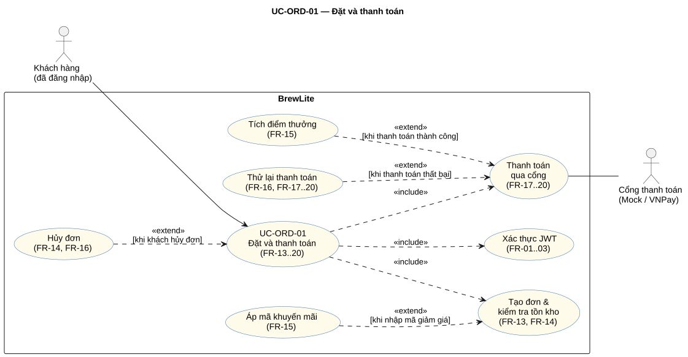

# ĐẶC TẢ USE-CASE CHI TIẾT: ĐẶT VÀ THANH TOÁN

> **Mã Use-Case**: `UC-ORD-01`
> **Người phụ trách**: Tôn Thất Hạnh
> **Mã FR liên kết**: `FR-13`..`FR-16` (đặt hàng), `FR-17`..`FR-20` (thanh toán), `FR-01`..`FR-03` (xác thực), `FR-10`..`FR-12` (giỏ hàng), `FR-21`..`FR-22` (lịch sử đơn)
> **Sơ đồ liên quan**: `docs/diagrams/usecase-order-payment.svg` (nguồn `usecase-order-payment.puml`), `docs/diagrams/order-state-machine.svg`

---

## 1. THÔNG TIN CƠ BẢN

- **Actor (Tác nhân)**: Khách hàng đã đăng nhập (chính); Cổng thanh toán (Mock Gateway; VNPay Sandbox khi cấu hình, CI dùng mock/stub) và Barista/Admin (`role` `BARISTA`/`ADMIN`, nhận đơn sau khi `PAID`) là tác nhân phụ.
- **Mục tiêu (Goal)**: Khách hàng biến giỏ hàng thành một đơn hàng và thanh toán không dùng tiền mặt để đơn được chuyển cho quầy pha chế.
- **Trigger (Sự kiện kích hoạt)**: Khách nhấn **“Tiến hành đặt hàng”** trong màn hình giỏ hàng.
- **Tiền điều kiện (Pre-conditions)**:
  1. Khách đã đăng nhập và có JWT còn hạn (FR-01..03).
  2. Giỏ hàng có ít nhất 1 món; mỗi món có size, số lượng (và topping nếu có) hợp lệ (FR-10..12).
  3. Hệ thống và cơ sở dữ liệu hoạt động; cổng thanh toán có thể truy cập (hoặc stub trong CI).
- **Hậu điều kiện (Post-conditions)**:
  - **Thành công**: Đơn ở `PAID`, có `orderNumber`; nguyên liệu đã trừ; `paid_at` được đặt; khách được cộng `floor(finalAmount / 1000)` điểm và `pointsEarned` của đơn được ghi; có 1 bản ghi `payments` thành công; lịch sử trạng thái ghi `NULL → PENDING → PAID`; giỏ hàng được xóa; khách thấy màn hình xác nhận; đơn hiển thị ở tab **Chờ pha** của Barista.
  - **Thanh toán thất bại / hủy tại cổng**: Đơn ở `PAYMENT_FAILED`; nguyên liệu **vẫn được giữ**; giỏ hàng phía client **được giữ nguyên**; không cộng điểm; khách có thể thử lại hoặc hủy đơn.
  - **Khách hủy đơn**: Đơn ở `CANCELLED`; nguyên liệu được hoàn đúng 1 lần theo `order_ingredient_usages`; không cộng điểm.
  - **Lỗi trước khi tạo đơn** (đăng nhập, dữ liệu, tồn kho, mã giảm giá)**: Không có đơn mới; tồn kho không đổi; giỏ hàng giữ nguyên.
- **Use-case liên quan**: `«include»` Xác thực JWT, Tạo đơn & kiểm tra tồn kho, Thanh toán qua cổng, Tích điểm thưởng · `«extend»` Áp mã khuyến mãi, Thử lại thanh toán, Hủy đơn.

---

## 2. CÁC LUỒNG THỰC HIỆN (FLOW OF EVENTS)

### 2.1. Luồng chính (Main Success Flow - Sunny Day)
1. **Khách**: Mở giỏ hàng và nhấn “Tiến hành đặt hàng”; UI chuyển tới `/checkout`. *(FR-10..12)*
2. **Hệ thống**: Kiểm tra phiên đăng nhập (JWT). Hợp lệ thì tiếp tục (không hợp lệ → **Exc-1**). *(FR-01..03)*
3. **Hệ thống**: Hiển thị tóm tắt đơn, tổng tạm tính và ô nhập mã giảm giá. *(FR-13)*
4. **Khách**: Nhấn “Xác nhận đặt hàng”; UI gửi `POST /api/v1/orders` kèm `items` và `promotionCode?` (nếu có mã → **Alt-1**). *(FR-13)*
5. **API**: Validate dữ liệu đầu vào (DTO): `items` không rỗng, `quantity` từ 1 đến 99, `size` thuộc `{S,M,L}` (mặc định `M`), tối đa 3 topping không trùng mỗi dòng (sai → **Exc-2**). *(FR-13)*
6. **API**: `PricingService` tính đơn giá, phụ thu size, giá topping, `totalAmount` (backend là nguồn giá duy nhất); nếu có mã giảm giá thì thẩm định và tính `discountAmount` (mã sai → **Exc-4**). Cả hai bước diễn ra **trước** khi mở transaction. *(FR-13, FR-15)*
7. **API**: Mở transaction: kiểm tra người dùng, sản phẩm/topping còn bán (`isAvailable`). Quy các món và topping ra nhu cầu nguyên liệu theo công thức (cộng gộp theo nguyên liệu), rồi trừ tồn kho từng nguyên liệu (theo `id` tăng dần) bằng cập nhật có điều kiện (`stock ≥ nhu cầu` và nguyên liệu còn `isAvailable`). Thiếu nguyên liệu hoặc món/topping chưa có công thức → **Exc-3**. *(FR-14)*
8. **API**: Trong transaction, tạo `orders` (`PENDING`), `order_items`, `order_item_toppings` (snapshot giá), `order_ingredient_usages` (snapshot lượng nguyên liệu đã trừ) và lịch sử `NULL → PENDING`; ghi `discountAmount`, `finalAmount` đã tính trước transaction (`pointsEarned` giữ 0 cho tới khi thanh toán). *(FR-13, FR-15)*
9. **API**: Commit transaction; trả `201` kèm `orderId`, `orderNumber`, `finalAmount`. *(FR-13)*
10. **UI**: Chuyển tới `/checkout/payment?orderId=<orderId>` và hiển thị số tiền phải trả (giỏ hàng **chưa** bị xóa). *(FR-13)*
11. **Khách**: Chọn phương thức (Ví điện tử (`E_WALLET`) / Thẻ ngân hàng (`BANK_CARD`)) và xác nhận (→ **Alt-2**). UI sinh `Idempotency-Key` (UUID) và gửi `POST /api/v1/payments`. *(FR-17, FR-18)*
12. **API**: Tạo bản ghi thanh toán, chuyển khách sang gateway theo cấu hình (`MOCK` mặc định trên giao diện hiện tại; có hỗ trợ `VNPAY` Sandbox). *(FR-17)*
13. **Khách**: Hoàn tất xác thực trên cổng (quét mã / nhập OTP). Thất bại hoặc hủy → **Exc-5, Exc-6**. *(FR-17, FR-19)*
14. **Cổng → Browser (Return URL)**: Cổng chuyển hướng trình duyệt về Frontend. UI có thể gửi nguyên query có chữ ký tới Backend IPN handler như fallback, sau đó đọc `GET /api/v1/payments/:paymentId` kèm JWT để hiển thị. Browser không tự quyết định trạng thái từ query; Backend vẫn phải kiểm tra HMAC, số tiền, tham chiếu và mã kết quả theo cùng contract IPN. (FR-17, FR-20)

15. **Cổng → Backend (IPN)**: Cổng gửi thông báo server-to-server đến Backend qua IPN. Backend kiểm tra chữ ký, số tiền, thông tin giao dịch và tính idempotent. Chữ ký hoặc dữ liệu không hợp lệ → **Exc-7**; IPN lặp → **Exc-8**; IPN thành công hợp lệ đến sau khi đơn đã `CANCELLED` → **Exc-10**. (FR-17..19)

**Lưu ý:** Return URL và IPN là hai luồng độc lập, có thể tới theo bất kỳ thứ tự nào. Kết quả chỉ được xác nhận sau khi Backend xử lý payload hợp lệ qua IPN handler, kể cả payload do UI chuyển tiếp như fallback. Chưa có xác nhận thì giữ Payment `PENDING` và giữ giỏ.

16. **API**: Khi IPN hợp lệ xác nhận thanh toán thành công và đơn đang `PENDING`, cập nhật Payment thành `SUCCESS`, thực hiện `OrderService.transition(PENDING → PAID)`, đặt `paid_at` và ghi lịch sử trạng thái. Nếu đơn đã `CANCELLED`, xử lý riêng theo **Exc-10**, không chuyển trạng thái đơn. (FR-16..19)

17. **API**: Chỉ trong trường hợp chuyển `PENDING → PAID` thành công, cộng điểm thưởng qua `LoyaltyService.award()` trong cùng transaction: `points = floor(finalAmount / 1000)`, ghi 1 bản ghi `EARNED`, tăng `loyaltyPoints`, ghi `orders.pointsEarned` (một lần cho mỗi đơn; đơn dưới 1.000đ không có điểm). Trường hợp **Exc-10** không cộng điểm. (FR-15)

18. **UI**: Khi Backend xác nhận đơn đã `PAID`, xóa giỏ hàng và hiển thị màn hình xác nhận: mã đơn `#orderNumber`, trạng thái `PAID`; đơn xuất hiện trong lịch sử. Nếu Browser đã quay về qua Return URL nhưng IPN chưa được Backend xử lý xác nhận, hiển thị trạng thái đang xử lý và giữ giỏ hàng. (FR-20, FR-21..22)

19. **Barista**: Nhận đơn ở tab **Chờ pha** và xử lý tiếp (`PREPARING → READY → COMPLETED`) — nằm ngoài use-case này, xem máy trạng thái. (FR-16)

### 2.2. Các luồng thay thế (Alternative Flows)
- **Alt-1: Áp mã giảm giá**:
  - Điều kiện rẽ nhánh: Khách nhập mã giảm giá ở bước 3–4
  - Diễn biến: API thẩm định mã (tồn tại, còn hạn, đủ đơn tối thiểu) và tính giảm giá: `WELCOME10` = min(10%, 20.000đ), đơn ≥ 40.000đ; `GIAM15K` = 15.000đ, đơn ≥ 60.000đ. Ví dụ: tổng 120.000đ + `WELCOME10` → giảm 12.000đ, trả 108.000đ, +108 điểm. Quay lại bước 8. *(FR-15)*
- **Alt-2: Chọn phương thức thanh toán**:
  - Điều kiện rẽ nhánh: Khách chọn phương thức thanh toán khác nhau ở bước 11
  - Diễn biến: Ví điện tử hoặc Thẻ ngân hàng cùng đi qua một luồng thanh toán; chỉ khác tham số `method`. *(FR-17)*
- **Alt-3: Thử lại thanh toán sau khi lỗi**:
  - Điều kiện rẽ nhánh: Đơn đang `PAYMENT_FAILED`, khách chọn “Thử lại thanh toán”
  - Diễn biến: Đơn chuyển `PAYMENT_FAILED → PENDING` (nguyên liệu vẫn đang giữ), khách quay lại bước 11 với `Idempotency-Key` mới. *(FR-16, FR-19)*
- **Alt-4: Khách hủy đơn**:
  - Điều kiện rẽ nhánh: Khách chọn “Hủy đơn” khi đơn `PENDING` hoặc `PAYMENT_FAILED`
  - Diễn biến: `POST /api/v1/orders/:id/cancel` (chỉ chủ đơn; đơn người khác → `404`): đơn → `CANCELLED`, hoàn nguyên liệu đúng 1 lần, ghi lịch sử (`reason = "Customer cancelled"`). Đơn ở trạng thái khác → `409`. Use-case kết thúc. *(FR-14, FR-16)*

### 2.3. Các luồng ngoại lệ / Lỗi (Exception Flows)
- **Exc-1: Chưa đăng nhập hoặc token hết hạn**:
  - Tình huống: Chưa đăng nhập hoặc token hết hạn (bước 2/4)
  - Xử lý của hệ thống: Từ chối, không tạo đơn; UI điều hướng tới trang đăng nhập; giỏ hàng giữ nguyên. Kết quả: `401`.
- **Exc-2: Dữ liệu đầu vào không hợp lệ**:
  - Tình huống: Dữ liệu không hợp lệ (bước 5): `items` rỗng, `quantity` ngoài 1..99, `size` sai, quá 3 topping hoặc topping trùng; sản phẩm/topping không tồn tại hoặc ngừng bán; người dùng không còn trong CSDL
  - Xử lý của hệ thống: Từ chối, không tạo đơn, không đổi tồn kho. Kết quả: `400` (người dùng không tồn tại: `404`).
- **Exc-3: Thiếu nguyên liệu (hoặc xung đột đồng thời)**:
  - Tình huống: Thiếu nguyên liệu (hoặc nguyên liệu bị tắt, hoặc món/topping chưa có công thức) khi trừ kho, kể cả do đơn khác đặt đồng thời vừa lấy hết (bước 7)
  - Xử lý của hệ thống: Rollback toàn bộ transaction (kể cả các món đã trừ kho); không tạo đơn; UI báo lỗi, giữ giỏ, cho phép gửi lại. Kết quả: `400`.
- **Exc-4: Mã giảm giá không hợp lệ**:
  - Tình huống: Mã giảm giá không tồn tại / hết hạn / chưa đủ đơn tối thiểu (bước 6)
  - Xử lý của hệ thống: Từ chối trước khi mở transaction; không tạo đơn, không đổi tồn kho; UI báo mã không hợp lệ. Kết quả: `400`.
- **Exc-5: Thanh toán thất bại**:
  - Tình huống: Thanh toán thất bại (thẻ bị từ chối, lỗi mạng tại cổng)
  - Xử lý của hệ thống: `PENDING → PAYMENT_FAILED`; giữ tồn kho và giỏ; hiển thị “Thử lại thanh toán” / “Hủy đơn”. Kết quả: Đơn `PAYMENT_FAILED`.
- **Exc-6: Khách hủy thanh toán tại cổng**:
  - Tình huống: Khách hủy thanh toán tại cổng
  - Xử lý của hệ thống: Xử lý như **Exc-5**. Kết quả: Đơn `PAYMENT_FAILED`.
- **Exc-7: Chữ ký hoặc dữ liệu IPN không hợp lệ**:
  - Tình huống: IPN có chữ ký không hợp lệ, số tiền hoặc thông tin giao dịch không khớp với dữ liệu thanh toán của đơn.
  - Xử lý của hệ thống: Backend từ chối IPN; không cập nhật Payment thành `SUCCESS`, không thay đổi trạng thái đơn và không cộng điểm. Kết quả: Từ chối thông báo.

- **Exc-8: Gửi lại cùng Idempotency-Key / IPN lặp**:
  - Tình huống: Khách nhấn đúp hoặc gửi lại cùng `Idempotency-Key`; cổng gọi lại IPN.
  - Xử lý của hệ thống: Trả lại kết quả đã lưu; không tạo payment mới, không xử lý chuyển trạng thái hoặc cộng điểm lần hai. Cùng key nhưng khác nội dung → từ chối. Kết quả: Kết quả cũ / `409` đối với key xung đột.

- **Exc-9: Chuyển trạng thái đơn không hợp lệ**:
  - Tình huống: Có yêu cầu chuyển trạng thái không thuộc 9 chuyển tiếp hợp lệ, ví dụ `PENDING → COMPLETED` hoặc `PAID → READY`.
  - Xử lý của hệ thống: `assertTransition()` từ chối; trạng thái đơn và lịch sử không thay đổi. Kết quả: `409 ConflictException`.

- **Exc-10: IPN thanh toán thành công đến sau khi đơn đã CANCELLED**:
  - Tình huống: Backend nhận được IPN xác nhận thanh toán thành công, chữ ký và dữ liệu giao dịch hợp lệ, nhưng đơn đã ở trạng thái `CANCELLED`.
  - Xử lý của hệ thống: Cập nhật Payment thành `SUCCESS`; đánh dấu giao dịch cần hoàn tiền thủ công; giữ nguyên Order ở trạng thái `CANCELLED`; không gọi chuyển trạng thái đơn và không cộng điểm thưởng. Backend trả phản hồi IPN thành công với `RspCode: '00'` để VNPay không gửi lại thông báo.
  - Kết quả: Payment `SUCCESS`; Order `CANCELLED`; cần hoàn tiền thủ công; không phát sinh loyalty points; IPN nhận `RspCode: '00'`.

---

## 3. TIÊU CHÍ KIỂM THỬ TỪ ACCEPTANCE CRITERIA (AC MAPPING)

Mỗi kịch bản dưới đây có đủ đầu vào, điều kiện và kết quả mong đợi để viết trực tiếp một test. Test ID của kịch bản luồng chính là test end-to-end (Playwright, SP2-08); các kịch bản còn lại dùng Test ID của AC trong [fr-order.md](fr-order.md).

- `AC-UC-01`: **Luồng chính** — Khách đăng nhập, giỏ 120.000đ + `WELCOME10`, kho đủ, thanh toán OK ➔ Đơn `PAID`; trả 108.000đ; khách +108 điểm; kho trừ đúng; lịch sử `NULL→PENDING→PAID` (AC-13.1, AC-15.1, AC-15.2) ➔ Test ID: `TC-UC-01` (E2E); thành phần: `TC-ORDER-01`, `TC-ORDER-04`, `TC-ORDER-26`
- `AC-UC-02`: **Exc-1** — Không gửi token ➔ `401`; không có đơn (AC-13.6) ➔ Test ID: `TC-ORDER-11`
- `AC-UC-03`: **Exc-2** — `items = []` / `quantity = 0` hoặc `100` / `size = "XL"` / 4 topping ➔ `400`; không có đơn (AC-13.3, AC-13.4, AC-13.10, AC-13.11) ➔ Test ID: `TC-ORDER-08`, `TC-ORDER-09`, `TC-ORDER-15`, `TC-ORDER-16`
- `AC-UC-04`: **Exc-3** — Nguyên liệu X tồn 400, đặt 3 ly A (cần 600 X) ➔ `400`; X vẫn 400; không có đơn (AC-14.1) ➔ Test ID: `TC-ORDER-02`
- `AC-UC-05`: **Exc-3 (nhiều nguyên liệu / món)** — Giỏ cần X (đủ) và Y (thiếu); hoặc X tồn 500, giỏ 2A + 1B cần 550 X ➔ `400`; không nguyên liệu nào bị trừ (AC-14.1, AC-14.4) ➔ Test ID: `TC-ORDER-02`, `TC-ORDER-21`
- `AC-UC-06`: **Exc-3 (đồng thời)** — X đủ đúng 1 ly A, 2 request đồng thời ➔ 1 `201`, 1 `400`; X cuối 0 (AC-14.5) ➔ Test ID: `TC-ORDER-22`
- `AC-UC-07`: **Exc-4** — `WELCOME10` với đơn 39.000đ ➔ `400`; không có đơn (AC-15.4) ➔ Test ID: `TC-ORDER-28`
- `AC-UC-08`: **Exc-5 / Exc-6** — Mock FAILED hoặc IPN lỗi/hủy hợp lệ ➔ Đơn `PAYMENT_FAILED`; kho và giỏ vẫn giữ; không cộng điểm (AC-19.1..19.3, AC-15.11) ➔ Test ID: `TC-PAY-05`, `TC-PAY-17`, `TC-CART-04`, `TC-ORDER-35`
- `AC-UC-09`: **Alt-3** — Đơn `PAYMENT_FAILED`, thử lại ➔ Đơn về `PENDING`; kho không đổi (AC-16.7) ➔ Test ID: `TC-ORDER-42`
- `AC-UC-10`: **Alt-4** — Hủy đơn `PENDING` ➔ Đơn `CANCELLED`; nguyên liệu hoàn đủ; hủy lần 2 → `409` (AC-14.6, AC-14.7, AC-16.8) ➔ Test ID: `TC-ORDER-23`, `TC-ORDER-24`, `TC-ORDER-43`
- `AC-UC-11`: **Alt-4 (sai trạng thái / sai chủ)** — Hủy đơn `PAID`; hoặc hủy đơn của người khác ➔ `409`; hoặc `404` (AC-16.9, AC-16.10) ➔ Test ID: `TC-ORDER-44`, `TC-ORDER-45`
- `AC-UC-12`: **Exc-8** — Gửi 2 lần cùng `Idempotency-Key`, hoặc cổng gọi lại IPN thành công ➔ Chỉ 1 payment, 1 lần `PAID`, 1 lần cộng điểm; lời gọi thứ hai không đổi dữ liệu (lớp payment trả kết quả cũ; nếu lọt xuống `transition()` thì `PAID → PAID` bị chặn `409`) (AC-15.10, AC-18.2, AC-18.4) ➔ Test ID: `TC-ORDER-34`, `TC-PAY-03`, `TC-PAY-08`
- `AC-UC-13`: **Exc-9** — Có yêu cầu chuyển trạng thái không hợp lệ, ví dụ `PENDING → COMPLETED` hoặc `PAID → READY` ➔ `409 ConflictException`; trạng thái đơn và lịch sử không đổi (AC-16.3, AC-16.6) ➔ Test ID: `TC-ORDER-06`, `TC-ORDER-41`
- `AC-UC-14`: **Exc-10** — IPN thành công hợp lệ đến sau khi đơn đã `CANCELLED` ➔ Payment `SUCCESS`; Order giữ `CANCELLED`; đánh dấu cần hoàn tiền thủ công; không cộng điểm; trả `RspCode: '00'`. ➔ Test ID: `TC-PAY-18` (Integration; owner Kiệt kiểm chứng ở Sprint 2).

---

## 4. RANH GIỚI PHẠM VI THEO PHÂN CÔNG

- **Tôn Thất Hạnh (SP1-06)**: FR-13..16, use-case trọng tâm UC-ORD-01 và sơ đồ state machine (`usecase-order-payment.*`, `order-state-machine.*`, ADR-006).
- **Quách Tuấn Hào (SP1-05)**: FR-01..03, FR-10..12 và `activity-e2e.*`; use-case này chỉ tham chiếu xác thực và giỏ hàng làm tiền điều kiện/đầu vào.
- **Nguyễn Trần Gia Kiệt (SP1-07)**: FR-17..20 và `sequence-checkout.*`; phần thanh toán trong use-case mô tả contract tích hợp, không thay thế đặc tả payment hoặc sequence diagram của Kiệt.
- **Nguyễn Quang Huy (SP1-08)**: FR-21..22 và API đọc lịch sử/chi tiết; các API này chỉ được tham chiếu, không được nhận thành AC thuộc FR-16.

## 5. GHI CHÚ ĐỐI CHIẾU VỚI REPO (KHÔNG THAY ĐỔI FILE CỦA THÀNH VIÊN KHÁC)

1. Frontend dùng route `/checkout/payment?orderId=<orderId>` sau khi tạo đơn, không dùng `/payment/[orderId]`.
2. Backend hỗ trợ gateway `MOCK` và `VNPAY`; màn hình hiện đặt `MOCK` làm lựa chọn khởi đầu. Payment/sequence vẫn thuộc SP1-07.
3. `AdminOrdersController` hiện chỉ cho `ADMIN`; route advance đang có là `PATCH /api/v1/admin/orders/:id/advance`. Chưa có API `BARISTA` hoặc API hủy đơn `PAID`, dù state machine vẫn khai báo cặp `PAID → CANCELLED`.
4. PR #5 đã sửa lỗi xóa giỏ trước redirect VNPay: UI hiện giữ giỏ khi sang cổng và chỉ gọi `clearCart()` sau khi Backend trả Payment `SUCCESS`. Return URL có fallback gửi signed query tới IPN handler rồi đọc Payment theo JWT; xem FR-20 và `sequence-checkout.puml`. Kiểm chứng Sandbox đầy đủ thuộc Sprint 2.

---

## 6. QUY TẮC NGHIỆP VỤ ÁP DỤNG

1. Giá, tổng tiền, giảm giá và điểm do backend tính; client không gửi số tiền (quy tắc #9).
2. Tạo đơn và trừ kho trong cùng một transaction; không dùng quá lượng nguyên liệu còn lại.
3. Với đơn đã tồn tại, chỉ `OrderService.transition()` cập nhật `Order.status`; `OrdersService.create` khởi tạo đơn mới ở `PENDING`. Cộng điểm và hoàn nguyên liệu do bên gọi thực hiện sau `transition()`, trong cùng transaction; máy trạng thái có 9 chuyển tiếp hợp lệ (xem [fr-order.md](fr-order.md) mục FR-16).
4. Đơn `PENDING` / `PAYMENT_FAILED` giữ nguyên liệu đã trừ cho tới khi `PAID` hoặc `CANCELLED`.
5. Điểm thưởng: 1 điểm cho mỗi 1.000đ thực trả, cộng một lần khi đơn `PAID`.
6. Repo hỗ trợ `MOCK` và `VNPAY`; giao diện hiện đặt `MOCK` làm lựa chọn mặc định. Khi dùng VNPay Sandbox:
   - Return URL điều hướng Browser về Frontend. UI chuyển tiếp signed query như fallback; chỉ Backend IPN handler mới xác minh và cập nhật Payment/Order, sau đó UI đọc trạng thái qua API có JWT.
   - IPN gửi server-to-server đến Backend; Backend kiểm tra chữ ký, số tiền và thông tin giao dịch trước khi xử lý cập nhật thanh toán.
   - IPN và yêu cầu thanh toán phải được xử lý idempotent. IPN thành công hợp lệ đến sau khi Order đã `CANCELLED` được xử lý theo Exc-10: Payment `SUCCESS`, đánh dấu cần hoàn tiền thủ công, giữ Order `CANCELLED`, không cộng điểm và trả `RspCode: '00'`.
   Đây là tích hợp VNPay Sandbox, không phải thanh toán tiền thật.

---

## 7. TRUY VẾT

| Thành phần | FR | Sơ đồ | API / code |
| :-- | :-- | :-- | :-- |
| Xác thực (bước 2, Exc-1) | `FR-01`..`FR-03` | [usecase-order-payment](../diagrams/usecase-order-payment.svg) | `JwtAuthGuard` |
| Tạo đơn (bước 4–10, Exc-2) | `FR-13` | [usecase-order-payment](../diagrams/usecase-order-payment.svg) | `POST /api/v1/orders` |
| Tồn kho nguyên liệu (bước 7, Exc-3, Alt-4) | `FR-14` | [usecase-order-payment](../diagrams/usecase-order-payment.svg) | transaction; cập nhật có điều kiện `ingredients.stock`; `order_ingredient_usages` |
| Khuyến mãi, điểm thưởng (Alt-1, Exc-4, bước 17) | `FR-15` | [usecase-order-payment](../diagrams/usecase-order-payment.svg) | `PromotionsService`, `LoyaltyService` |
| Trạng thái đơn (bước 16, Alt-3, Alt-4, Exc-9) | `FR-16` | [order-state-machine](../diagrams/order-state-machine.svg) | `assertTransition`, `OrderService.transition()` |
| Thanh toán (bước 11–16, Exc-5..Exc-8, Exc-10) | `FR-17`..`FR-20` | `sequence-checkout` (Kiệt) | `POST /api/v1/payments`; VNPay Return URL (Browser → Frontend), IPN (VNPay → Backend) |
| Xác nhận sau thanh toán | `FR-20` (Kiệt) | `activity-e2e` (Hào, sơ đồ luồng E2E) | Giao diện xác nhận và xử lý giỏ sau thanh toán; chi tiết payment thuộc SP1-07 |
| Xem lịch sử / chi tiết đơn | `FR-21`..`FR-22` (Quang Huy) | Tài liệu / sơ đồ History tương ứng | `GET /api/v1/orders/me`, `GET /api/v1/orders/:id` (ngoài phạm vi SP1-06) |
